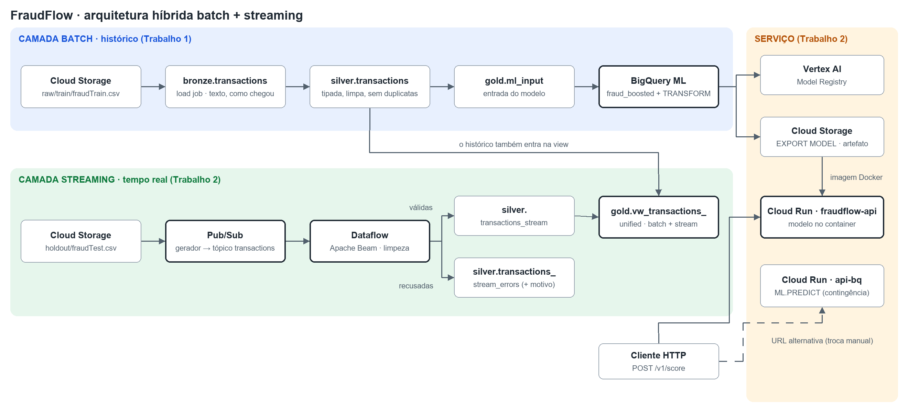

# FraudFlow

Detecção de fraude em transações de cartão na Google Cloud, do histórico ao
tempo real. Projeto da disciplina **Processamento de Dados Massivos**, em três
entregas que evoluem a mesma solução.

| Entrega | Escopo | Datas |
|---|---|---|
| Trabalho 1 | Arquitetura Medallion no BigQuery e modelo em BigQuery ML | apresentado em 11/09/2026 |
| **Trabalho 2** | **Streaming (Pub/Sub + Dataflow), modelo servido por uma API no Cloud Run** | entrega 04/11/2026 · apresentação 06/11/2026 |
| Trabalho Final | Dataflow chamando a API em tempo real e orquestração | 04/12/2026 |

## Links do Trabalho 2

| O quê | Endereço |
|---|---|
| API de pontuação | https://fraudflow-api-189235868606.us-central1.run.app |
| Contrato interativo da API (teste pelo navegador) | https://fraudflow-api-189235868606.us-central1.run.app/docs |
| API de contingência (`ML.PREDICT`) | https://fraudflow-api-bq-189235868606.us-central1.run.app |
| Repositório | https://github.com/Palharess/fraudflow |

---

## A arquitetura em uma imagem



Versão vetorial em [`docs/arquitetura.svg`](docs/arquitetura.svg). As duas
imagens saem de [`docs/gerar_diagrama.py`](docs/gerar_diagrama.py).

É uma **arquitetura híbrida batch + streaming**, organizada em três camadas:

- **Batch (histórico).** Processa um volume grande de uma vez: 1,3 milhão de
  transações de 2019 a junho de 2020. É dele que sai o modelo. Foi o
  Trabalho 1, e continua igual.
- **Streaming (tempo real).** Processa transação por transação, assim que ela
  acontece, com a mesma limpeza da camada batch. É o que o Trabalho 2 acrescenta.
- **Serviço.** Entrega o resultado: a view que junta histórico e tempo real
  numa tabela só, e a API que dá o score de fraude de uma transação em
  milissegundos.

As duas fontes se completam no tempo. O histórico vai até **21/06/2020
12:13:37**, e o tempo real começa em **21/06/2020 12:14:25**, que é a
transação seguinte do dataset. Na view, a linha do tempo continua sem buraco
nem sobreposição.

O tempo real é um **replay**: as transações de 2020 do `fraudTest.csv` são
publicadas agora, uma a uma, como se estivessem acontecendo. Cada uma mantém o
horário original, e o horário da publicação fica registrado à parte.

---

## O caminho de uma transação

Para entender o sistema, vale seguir uma transação real do começo ao fim.

**1. O gerador publica o evento.** O `producer/publisher.py` lê o `fraudTest.csv`
na ordem do arquivo e publica cada linha no Pub/Sub, um serviço de fila de
mensagens. O evento leva os campos de origem, com os nomes e o formato de texto
do CSV:

```json
{"trans_num": "2da90c7d74bd46a0caf3777415b3ebd3", "trans_date_trans_time": "2020-06-21 12:14:25",
 "cc_num": "2291163933867244", "merchant": "fraud_Kirlin and Sons", "category": "personal_care",
 "amt": "2.86", "lat": "33.9659", "long": "-80.9355", "state": "SC", "city_pop": "333497",
 "dob": "1968-03-19", "merch_lat": "33.986391", "merch_long": "-81.200714",
 "published_at": "2026-11-03T15:01:42.186+00:00"}
```

O rótulo `is_fraud` **não** vai no evento: na vida real, ninguém sabe na hora
da compra se ela é fraude. Também ficam de fora nome, endereço, gênero e
profissão, que o projeto decidiu não usar desde o Trabalho 1.

**2. O Dataflow limpa.** O Dataflow é o serviço do Google que executa pipelines
escritos com Apache Beam. O nosso (`streaming/pipeline.py`) lê cada mensagem e
aplica as mesmas regras da camada Silver (`streaming/limpeza.py`):

- renomeia (`amt` → `amount`, `trans_num` → `transaction_id`);
- converte os tipos (texto → número, data, horário);
- tira o prefixo `fraud_` dos comerciantes, um artefato do gerador do dataset;
- valida: valor positivo, coordenadas possíveis, nascimento antes da compra.

**3. A transação vai para uma de duas tabelas.** Se passar, entra em
`silver.transactions_stream`. Se não passar, entra em
`silver.transactions_stream_errors`, com o motivo (`valor_nao_positivo`,
`json_invalido`...) e o evento original. Um evento estragado não derruba o
pipeline: ele fica registrado para alguém investigar.

**4. A view junta histórico e tempo real.** `gold.vw_transactions_unified` mostra
as duas tabelas como uma só, com a coluna `origin` (`batch` ou `stream`). A
transação acima aparece logo depois da última do histórico:

| origin | quando | categoria | valor | is_fraud |
|---|---|---|---|---|
| batch | 21/06/2020 12:13:37 | food_dining | 4.30 | 0 |
| stream | 21/06/2020 12:14:25 | personal_care | 2.86 | *(vazio)* |

O `is_fraud` vazio no stream é proposital: o rótulo chega dias depois, com a
contestação da compra.

**5. A API dá o score.** Qualquer sistema pode perguntar à API se uma transação
parece fraude:

```bash
curl -X POST https://fraudflow-api-189235868606.us-central1.run.app/v1/score \
  -H 'Content-Type: application/json' -d '{
    "transaction_id": "2da90c7d74bd46a0caf3777415b3ebd3",
    "transaction_ts": "2020-06-21 12:14:25", "customer_dob": "1968-03-19",
    "customer_lat": 33.9659, "customer_long": -80.9355,
    "merchant_lat": 33.986391, "merchant_long": -81.200714,
    "amount": 2.86, "category": "personal_care", "city_pop": 333497
  }'
```

| Campo da resposta | Significado |
|---|---|
| `fraud_score` | score do modelo, de 0 a 1. Quanto maior, mais parecida com as fraudes do treino |
| `modelo` | versão do modelo e de onde veio o artefato |
| `backend` | `modelo-local` (principal) ou `bigquery-ml-predict` (contingência) |
| `latencia_ms` | tempo da inferência dentro da API |
| `transaction_id` | o mesmo id enviado, para rastrear a resposta |

O `fraud_score` não é uma probabilidade calibrada. O modelo foi treinado
compensando a raridade da fraude (0,5% dos casos), então o número serve para
ordenar e comparar transações, e não para dizer "X% de chance".

---

## O dataset

[Credit Card Transactions Fraud Detection](https://www.kaggle.com/datasets/kartik2112/fraud-detection),
gerado pelo simulador Sparkov: 1.852.394 transações entre 2019 e 2020, com 9.651
fraudes (0,52%). O dataset já vem dividido em dois arquivos, e a divisão é
**temporal**:

| Arquivo | Período | Uso |
|---|---|---|
| `fraudTrain.csv` (1.296.675 linhas) | 01/01/2019 → 21/06/2020 12:13:37 | camada batch: treino e validação do modelo |
| `fraudTest.csv` (555.719 linhas) | 21/06/2020 12:14:25 em diante | camada streaming: reproduzido como tempo real |

O `fraudTest` nunca foi usado para treinar nem para escolher parâmetros do
modelo. No Trabalho 2, ele vira o "futuro": transações que o modelo nunca viu,
chegando uma a uma.

**Uma armadilha do dataset.** As duas colunas de tempo discordam em exatamente
sete anos: `trans_date_trans_time` diz 2019–2020, e `unix_time`, na mesma linha,
diz 2012–2013. O projeto usa só a primeira. Calcular a idade pela coluna errada
deixaria todo cliente sete anos mais novo, sem dar erro nenhum.

---

## Camada batch (Trabalho 1)

```
GCS raw/train/  →  BRONZE (texto, como chegou)  →  SILVER (tipada, limpa, sem duplicatas)
                                                       ├→ GOLD ml_input         → BigQuery ML
                                                       └→ GOLD fraud_analytics  → agregados para BI
```

- **Bronze:** o CSV carregado como texto, com a data da carga e o arquivo de origem.
- **Silver:** tipagem, limpeza, deduplicação e nomes canônicos. Particionada pela
  data da transação e agrupada (*cluster*) por categoria.
- **Gold:** a entrada do modelo e os agregados de negócio.
- **Modelo:** todas as features nascem dentro da cláusula `TRANSFORM` do
  `CREATE MODEL`. A transformação é salva junto com o modelo, então a mesma
  fórmula vale no treino e na API. Não existe uma segunda implementação em
  Python que poderia divergir.

| Feature | Como é calculada |
|---|---|
| `amount`, `log_amount` | valor da compra e seu logaritmo |
| `category` | categoria do comerciante |
| `hour`, `day_of_week`, `is_night` | a partir do horário da transação; madrugada = 22h às 3h |
| `age` | idade completa no dia da compra |
| `distance_km` | distância entre cliente e comerciante (fórmula de Haversine) |
| `city_pop` | população da cidade do cliente |

**Resultados**, nos 20% finais do histórico, que o modelo não viu no treino
(limiar 0,5):

| Modelo | Recall | Precision | F1 | ROC AUC |
|---|---|---|---|---|
| v1 · regressão logística | 0,867 | 0,041 | 0,079 | 0,949 |
| v2 · boosted tree | **0,970** | **0,307** | **0,466** | **0,998** |

O v2 encontra 97 de cada 100 fraudes, marcando 1,31% das transações legítimas
para revisão. Ele é o modelo servido pela API. Acurácia não é usada: responder
"não é fraude" para tudo daria 99,41%.

O passo a passo do Trabalho 1 está nos notebooks `00` a `04` e em [`sql/`](sql/README.md).

---

## Camada streaming (Trabalho 2)

| Peça | Onde | O que faz |
|---|---|---|
| Gerador | [`producer/publisher.py`](producer/publisher.py) | reproduz o `fraudTest.csv` no Pub/Sub em ritmo constante (`--taxa`) |
| Fila | Pub/Sub, tópico `transactions` | recebe os eventos; a assinatura guarda por 1 dia o que ainda não foi lido |
| Pipeline | [`streaming/pipeline.py`](streaming/pipeline.py) | lê, limpa e grava, rodando no Dataflow |
| Regras | [`streaming/limpeza.py`](streaming/limpeza.py) | as regras da Silver em Python puro, testáveis sem nuvem |
| Tabelas | [`sql/stream/40`](sql/stream/40_tabelas_stream.sql) | válidas e erros |
| View | [`sql/stream/41`](sql/stream/41_vw_transactions_unified.sql) | histórico + tempo real |
| Consultas da demo | [`sql/stream/42`](sql/stream/42_consultas_demo.sql) | contagens, emenda, atraso, erros, duplicatas |

### Decisões e por quê

**Horário do evento, não horário de chegada.** Cada transação mantém o horário
original, de 2020. O horário em que foi publicada (`published_at`) e o horário
em que foi processada (`processed_at`) ficam em colunas separadas. Trocar pelo
horário atual estragaria o modelo: `hour`, `is_night` e `age` saem do horário
da transação, e a madrugada concentra 18 vezes mais fraude. Numa demonstração
às 10h, toda fraude pareceria diurna. Em streaming, essa diferença tem nome:
*event time* contra *processing time*.

**Mesma partição e mesmo cluster da Silver.** `transactions_stream` é
particionada pela data da transação e agrupada por categoria, como a
`silver.transactions`. Consultas por período leem só as partições do período,
e filtros por categoria leem menos blocos. Como as duas tabelas têm o mesmo
formato, a view funciona como uma tabela só.

**Erros numa tabela, não no chão.** Evento inválido não para o pipeline e não
some: vai para `transactions_stream_errors` com o motivo e o conteúdo original.
A tabela de erros é particionada pela data de processamento, que é como a
operação a consulta, e apaga partições com mais de 30 dias.

**Duplicatas em duas camadas.** O Pub/Sub garante entrega *pelo menos uma vez*,
então a mesma mensagem pode chegar duas vezes.
- O Dataflow descarta reenvios com o mesmo `transaction_id` publicados dentro
  de 10 minutos.
- A view mantém só a primeira chegada de cada transação, em qualquer intervalo.
- A tabela física guarda tudo o que chegou, para auditoria.

**Eventos inválidos de teste, sem estragar os reais.** O dataset é limpo: a
Silver não descartou nenhuma das 1,3 milhão de linhas. Para demonstrar a
limpeza, o gerador intercala eventos estragados sintéticos (`--invalidos N`),
com ids próprios (`teste-invalido-...`). As transações reais nunca são
alteradas.

**Um worker fixo.** O volume da demonstração (dezenas de eventos por segundo)
cabe numa máquina, e o custo fica previsível.

---

## Camada de serviço (Trabalho 2)

### O modelo

O `fraud_boosted` está registrado no **Vertex AI Model Registry**
(`fraudflow-boosted`, versão 2) e exportado para o Cloud Storage. A exportação
tem duas partes:

- **`transform/`:** o `TRANSFORM`, salvo como modelo TensorFlow;
- **`model.bst`:** o XGBoost, com os vocabulários das variáveis categóricas.

### A API

FastAPI empacotada em Docker e publicada no Cloud Run. O mesmo código roda em
dois serviços:

| Serviço | Como pontua | Latência mediana | Papel |
|---|---|---|---|
| `fraudflow-api` | modelo exportado carregado no próprio container | **51 ms** | principal |
| `fraudflow-api-bq` | consulta o `ML.PREDICT` do BigQuery | 613 ms | contingência, com URL própria |

Latência medida do Cloud Shell, de ponta a ponta (HTTP), em 50 chamadas: a
contingência foi cerca de 12 vezes mais lenta nesse teste. A troca é manual:
se a principal falhar, quem chama passa a usar a URL da contingência.

- **Validação da entrada:** as mesmas regras da Silver, mais a lista das 14
  categorias que o modelo conhece. Entrada inválida recebe **erro 422**,
  explicando o campo.
- **Inicialização:** o modelo é carregado uma vez, quando o servidor sobe. A
  instância só recebe tráfego depois disso.
- **Contas de serviço próprias:** a API principal não tem permissão nenhuma no
  GCP, porque o modelo está dentro da imagem. A contingência só pode consultar o
  BigQuery.
- **Imagem:** Python 3.11, usuário sem privilégios de administrador, versões das
  bibliotecas fixadas.

Detalhes em [`api/README.md`](api/README.md).

### Por que o modelo dentro do container, e não um endpoint do Vertex AI

O plano inicial era a API consultar um endpoint do Vertex AI. As tentativas de
implantação falharam com *Machine type temporarily unavailable* nos três tipos
de máquina testados, com a cota do projeto sobrando (24 CPUs). O Google estava
sem máquina disponível na região naquele momento. E modelos do BigQuery ML não
podem ser copiados para outra região.

O enunciado aceita que a API **carregue o modelo**. Com o modelo exportado
dentro da imagem:

- a API **não depende** de máquina reservada no Vertex no dia da apresentação;
- **não custa nada parada**. Um endpoint cobra por hora, mesmo sem tráfego;
- **responde mais rápido**, porque não há uma segunda chamada pela rede.

O modelo continua registrado no Vertex AI, e o endpoint segue possível no
futuro.

---

## Testes e evidências

Cada etapa só avançou com um teste de critério objetivo. As saídas completas
estão em [`docs/evidencias.md`](docs/evidencias.md).

| Teste | Critério | Resultado |
|---|---|---|
| Exportação do modelo (notebook 05) | o BigQuery exporta o modelo com o `TRANSFORM` | exportado: `model.bst` + `transform/` |
| Paridade dentro da imagem ([`api/scripts/paridade.py`](api/scripts/paridade.py)) | as 9 features iguais às do `ML.TRANSFORM` e o score igual ao do `ML.PREDICT`, em 50 transações | features iguais; diferença de score **0**; inferência de 2,2 ms (mediana) |
| API publicada por HTTP ([`api/scripts/paridade_http.py`](api/scripts/paridade_http.py)) | 50 respostas iguais ao `ML.PREDICT`, 422 para entrada inválida | aprovada nos dois serviços |
| Limpeza do streaming | cada tipo de evento inválido no motivo certo | 6 de 6 motivos corretos |
| Emenda batch → stream | linha do tempo contínua na view | 12:13:37 (batch) → 12:14:25 (stream) |
| Atraso do pipeline no Dataflow | da publicação no Pub/Sub até o início do processamento no Beam (`processed_at`) | **560 ms** em média, 3,2 s no percentil 95, em 1.050 eventos |
| Duplicatas | republicar 50 transações já gravadas | 1.250 linhas na tabela, **1.200 na view** |

---

## Problemas que encontramos e como resolvemos

**1. O modelo não exportava.** A mensagem dizia que o operador `<` só aceita
números na exportação. A documentação lista o `<` como suportado e não menciona
essa restrição. O culpado era o cálculo da idade, que comparava aniversários
como texto (`'0315' < '0702'`).

Para ter certeza, treinamos modelos de teste mínimos: o com a idade antiga
falhou, e o com a idade nova exportou.

A correção compara `mês × 100 + dia` como número. Antes de trocar, conferimos
que a idade dá a mesma nas 1.296.675 linhas. O v1 retreinado saiu idêntico; o
v2 variou menos de um ponto, por causa da amostragem aleatória do treino.

**2. O Vertex AI ficou sem máquina.** Descrito acima. Levou à decisão de
carregar o modelo no container.

**3. Um erro silencioso na biblioteca do Google.** Para rodar o modelo
exportado, usamos a biblioteca oficial `bigquery-ml-utils`. O primeiro teste de
paridade deu scores até 0,86 diferentes do BigQuery, sem nenhum erro.

A biblioteca entregava `is_night` ao XGBoost como `True`/`False`, mas o
vocabulário do modelo guarda `true`/`false`. Fora do vocabulário, a feature mais
importante do modelo virava "ausente" em todas as transações.

A correção converte o valor antes do XGBoost ([`api/app/modelo.py`](api/app/modelo.py)).
Depois dela, a diferença caiu para zero. Sem o teste de paridade, a API teria
funcionado, errando, sem nenhum aviso.

**4. Detalhes de ambiente.**
- **Python:** a biblioteca do modelo só roda em Python 3.10 ou 3.11, então o
  teste foi feito na imagem Docker, e não no Colab.
- **Leitura do arquivo:** a leitura do GCS em blocos de 40 MB atrasava o
  primeiro evento, e agora usa blocos de 1 MB.
- **Envio para o Dataflow:** o ambiente Python 3.12 do Cloud Shell não trazia o
  `setuptools`, necessário para enviar o pipeline.

---

## Como executar

Pré-requisitos:
- um projeto no Google Cloud com faturamento ativo;
- o Trabalho 1 executado: notebooks `00` a `04`, que criam as tabelas e o modelo;
- o Cloud Shell, que já tem `gcloud`, `bq`, Docker e Python autenticados.

Os scripts usam `fraudflow-pdm-gps` como projeto padrão. Para usar outro
projeto, defina a variável `PROJECT_ID` antes de rodar.

**1. Modelo.** O notebook [`05_validacao_modelo`](Notebooks/05_validacao_modelo.ipynb)
confere o registro e exporta o modelo para o Cloud Storage.

**2. API.** Na pasta `api/` ([detalhes](api/README.md)):

1. Baixe a exportação do modelo:
```bash
bash scripts/baixar_modelo.sh
```

2. Gere as 50 transações de teste com a referência do BigQuery:
```bash
bash scripts/gerar_amostra.sh
```

3. Construa a imagem:
```bash
docker build -t fraudflow-api:local .
```

4. Confira a paridade dentro da imagem:
```bash
docker run --rm -v "$PWD/scripts:/app/scripts:ro" -v "$PWD/teste:/teste:ro" fraudflow-api:local python scripts/paridade.py /teste/amostra.json
```

5. Publique a API principal:
```bash
bash deploy.sh local
```

6. Publique a contingência:
```bash
bash deploy.sh bigquery
```

**3. Streaming.** Na raiz do repositório:

1. Crie o tópico, a assinatura, as tabelas, a view e a conta do Dataflow:
```bash
bash infra/setup_streaming.sh
```

2. Crie os dois ambientes Python, um para o gerador e outro para o Beam:
```bash
python3 -m venv ~/venv-gerador && ~/venv-gerador/bin/pip install -r producer/requirements.txt
```
```bash
python3 -m venv ~/venv-beam && ~/venv-beam/bin/pip install -r streaming/requirements.txt
```

3. Ligue o pipeline no Dataflow (para testar sem custo de máquina, use `local` no lugar de `dataflow`):
```bash
source ~/venv-beam/bin/activate && bash streaming/run.sh dataflow
```

4. Com o job em execução, publique as transações. O `--inicio` diz de qual
   linha do `fraudTest.csv` começar; as 1.200 primeiras já foram processadas,
   então transações novas começam em 1200. Republicar linhas antigas só faz a
   tabela física crescer: a view continua igual, porque remove as duplicatas.
```bash
~/venv-gerador/bin/python producer/publisher.py --inicio 1200 --taxa 20 --limite 1000 --invalidos 6
```

**4. Consultas.** Rode as de [`sql/stream/42_consultas_demo.sql`](sql/stream/42_consultas_demo.sql)
no console do BigQuery.

**5. Desligar.**
```bash
bash infra/teardown.sh
```

---

## Custos

| Recurso | Quando cobra | Ordem de grandeza |
|---|---|---|
| Dataflow | enquanto o job está ligado | ~US$ 0,20–0,30 por hora com 1 worker (estimativa) |
| Cloud Run | só durante as requisições; parado, não cobra | centavos |
| Pub/Sub, BigQuery (gravação e consultas), Cloud Build | por uso | centavos |
| Armazenamento (GCS, imagens, tabelas) | por mês | centavos |
| Endpoint do Vertex AI | não usado | — |

Com a configuração do projeto, o único recurso que cobra por hora é o
Dataflow. Uma instância mínima no Cloud Run, se for ligada para a apresentação,
também passa a cobrar enquanto existir, e o armazenamento é cobrado sempre, em
centavos. O [`infra/teardown.sh`](infra/teardown.sh) desliga o que cobra por
hora, do mais caro ao mais barato:
- drena o job do Dataflow;
- apaga endpoints do Vertex AI;
- remove a instância mínima das revisões do Cloud Run, que é como o `deploy.sh` a configura.

Ele não apaga dados.

---

## Estrutura do repositório

```
Notebooks/   00–04  pipeline batch e modelo (Trabalho 1)
             05     validação e exportação do modelo (Trabalho 2)
sql/         bronze/ silver/ gold/ ml/  (Trabalho 1) · stream/  (Trabalho 2)
producer/    gerador de eventos para o Pub/Sub
streaming/   pipeline Apache Beam para o Dataflow
api/         API FastAPI: código, Dockerfiles, deploy no Cloud Run e testes de paridade
infra/       preparar o streaming e desligar o que cobra
docs/        diagrama da arquitetura (imagem e o script que a gera)
```

---

## Próximos passos (Trabalho Final)

- **O Dataflow chama a API** para cada transação e grava o score junto com o
  evento no BigQuery.
- **Faixas de decisão:** aprovar, revisar ou bloquear, com limiares escolhidos
  pela curva ROC na janela de validação.
- **Rótulos que chegam depois:** uma tabela de rótulos carregada em lote,
  simulando as contestações, permite medir o modelo sobre o tempo real.
- **Orquestração** do ciclo: subir o pipeline, conferir a chegada dos dados,
  checar a saúde da API.
